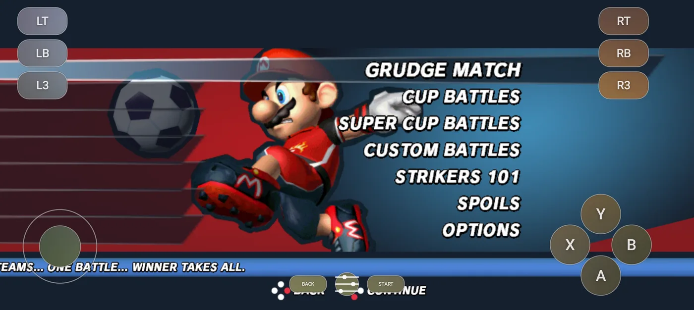
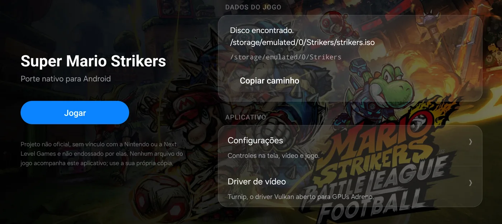
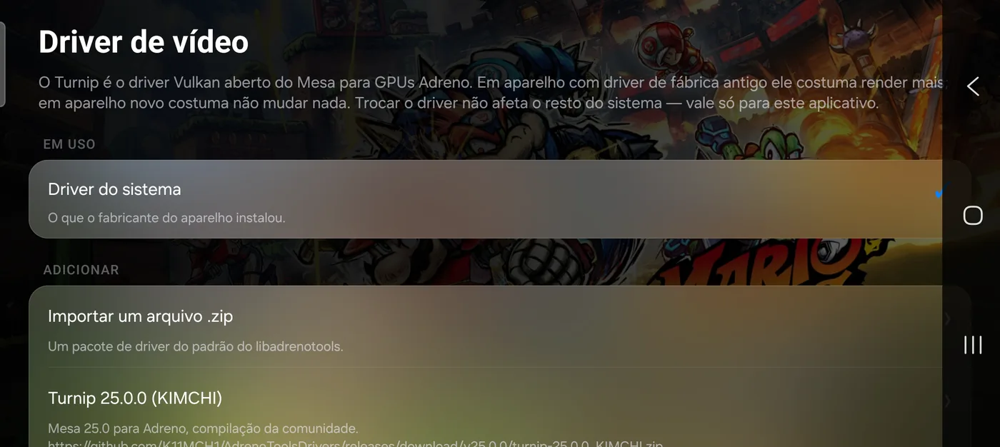

# Strikers — Android

Super Mario Strikers, running natively on an arm64 Android phone. Not an emulator: the same game
code and the same renderer as the desktop port, compiled for ARM and drawing through Vulkan.



*Requires game data from your own copy of Super Mario Strikers. **No game assets are included.***

## Download

[**`apk/strikers-android-1.2.0-arm64.apk`**](apk/) — arm64-v8a, Android 9 (API 28) or later, Vulkan
required. The checksum and a note on what the signature does and does not prove are in the same
folder.

## What it is

This repository is the Android side of [`new-coke/strikers`](https://github.com/new-coke/strikers),
the native PC port of the game, which in turn is built on the community decompilation by
[Yannick Suter](https://github.com/yannicksuter). The full history of that port is preserved here;
the Android work is one commit on top of it.

What is Android-specific lives in four native files and a Gradle project. Everything else — the
game, [Aurora](https://github.com/encounter/aurora), the renderer — is shared with the desktop port
and gets its fixes for free.

## The app



A launcher, not just a window with a game in it. It answers *"where is the disc?"* before loading
anything: the game itself would answer that perfectly well, but only after a black screen and a
process that then exits, which on a phone reads as a crash.

The game folder is `/Strikers` at the **root of shared storage**, not buried under `Android/data`,
so a file manager can actually reach it. That needs the all-files permission; without it the app
falls back to its private folder and says so.

- **On-screen controls in the Xbox 360 layout**, drawn by hand with a blurred-glass backdrop,
  multitouch finger-to-control locking and an adjustable dead zone. They hide themselves while a
  real controller is connected.
- **Settings** for video, controls and the game, projected into `strikers.ini` while preserving
  anything the player wrote there by hand — comments included.
- **A performance panel** in the style of a hardware monitor. It shows FPS and frame cost from the
  port's own limiter, plus RAM, temperature and GPU load *when the device exposes them* — and `--`
  when it does not, rather than a decorative number.
- **Nine languages**: English, Portuguese (Brazil), Spanish, French, German, Italian, Japanese,
  Simplified Chinese and Russian, switchable independently of the phone's own language.

## Video drivers



The game draws through Vulkan, and on Android the Vulkan driver is whatever the manufacturer
shipped. The app can load a different one — [Turnip](https://docs.mesa3d.org/drivers/freedreno.html),
Mesa's open driver for Adreno GPUs — through
[libadrenotools](https://github.com/bylaws/libadrenotools), by packaging its own `libvulkan.so` that
the loader finds before the system's.

On a device whose factory driver is old this usually goes faster. On a new device it usually changes
nothing, and the screen says so instead of selling an improvement that does not arrive. Changing the
driver affects this app only.

Packages can be imported from a `.zip` or downloaded from the list, whose addresses are on screen on
purpose: downloading one brings third-party code that runs inside the game.

## Building

Two steps, deliberately separate. The native build is CMake and the NDK, the same build every other
platform gets; Gradle only packages what it produced, so Gradle's own idea of which CMake and which
NDK to use never gets a vote.

```sh
tools/build-android.sh                    # the game  -> build-android/jniLibs/arm64-v8a/
cd android && ./gradlew assembleRelease   # the app   -> app/build/outputs/apk/release/
```

Details, requirements and the reasoning behind each Android-specific change are in
[`smstrikers-port/README-android.md`](smstrikers-port/README-android.md).

## Credits

- [Yannick Suter](https://github.com/yannicksuter) and contributors — the decompilation.
- [`new-coke/strikers`](https://github.com/new-coke/strikers) — the native port this is built on.
- [encounter/aurora](https://github.com/encounter/aurora) — GX/VI/PAD/CARD over WebGPU and SDL3.
- [bylaws/libadrenotools](https://github.com/bylaws/libadrenotools) — custom driver loading.
- Android port by Luis Santos — Brazil.

An unofficial project, unaffiliated with and not endorsed by Nintendo or Next Level Games. No game
files ship with this app; use your own copy.
